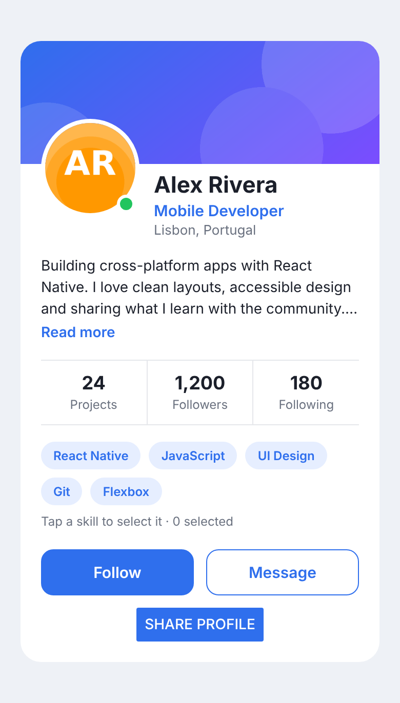
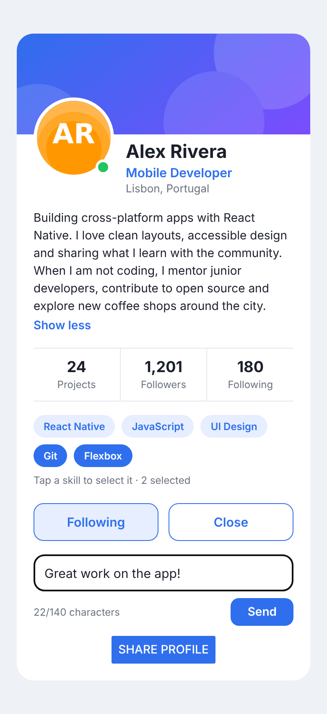

# Practical Task 2 — Interactive Profile Card

**Topic:** Handling events. Work with state
**Duration:** about 60 minutes
**Tools:** Visual Studio Code, Node.js (LTS), the Expo Go app on your phone (or an Android/iOS emulator)
**Previous task:** [Task 1 — Profile Card](../../task-1/student/) (layout and styling)

## Goal

In Task 1 you built a *static* profile card. Now you will make it **interactive**: press buttons, follow / unfollow, write a message, expand the bio and select skills.

| Initial state | Final result |
|---|---|
|  |  |

> The pictures are an approximation. Small differences between iOS, Android and your screen size are normal. The final picture shows: *Following*, followers `1,201`, expanded bio, two selected skills and the message composer.

## Learning objectives

After this task you will be able to:

- Handle events with `onPress` and explain why you pass a **function**, not a function call.
- Use the core `Button` and the more flexible `Pressable` components.
- Give visual feedback with the `style` **function** of `Pressable` (`({ pressed }) => ...`).
- Store data that changes over time with `useState` and update it with the setter function.
- Derive values from state instead of duplicating them (followers count).
- Update **arrays** in state without mutating them.
- Build a controlled input with `TextInput` (`value` + `onChangeText`).
- Show or hide parts of the UI with conditional rendering.

## Setup

Task 2 builds on Task 1. This folder is a complete Expo project whose `App.js` is the **solution of Task 1 plus some new data**.

> If you finished Task 1 you may copy your own `App.js` and adapt it, but we recommend starting from the provided `App.js` so everyone has the same base (it already uses a `ScrollView` and the long `BIO`).

1. Open this folder in VS Code (`code .`) and open the terminal (`Ctrl+\``).
2. Check that you are in the folder that contains `package.json`: `ls package.json`.
3. Install and start:

   ```bash
   npm install
   npx expo start
   ```

4. Scan the QR code with Expo Go (same Wi-Fi), or press `a` / `i` for an emulator. If the QR code does not connect, use `npx expo start --tunnel`.
5. Edit `App.js`. The app reloads every time you save.

### Common problems

| Problem | Solution |
|---|---|
| `npm error enoent ... package.json` | You are in the wrong folder. `cd` into the folder that contains `package.json`. |
| `Alert` does nothing in the browser (`w`) | `Alert.alert` only works on a phone or emulator. Test on Expo Go. |
| The keyboard covers the input on iOS | Scroll the card up. (The screen is a `ScrollView`, so you can.) |
| Nothing happens when you press a button | Did you write `onPress={handlePress}` (correct) or `onPress={handlePress()}` (wrong)? |
| `useState is not defined` | Add `import { useState } from 'react';` at the top. |

## The task

Work inside `App.js`. Search for the `TODO` comments: each one tells you the step. Build the interaction in **5 steps** and check your phone after each one.

### Step 1 — Events: `onPress` with `Pressable` and `Button` (10 min)

- Import `Pressable`, `Button` and `Alert` from `react-native`.
- Write three handler functions inside `App`: `handleFollowPress`, `handleMessagePress` and `handleSharePress`. For now each one calls `Alert.alert(title, message)`.
- Replace the two `View` buttons (*Follow*, *Message*) by `Pressable` components and pass the handlers with `onPress`. Keep the same styles and the same `Text` inside.
- Add the core `Button` with `title="Share profile"`, `color={COLORS.primary}` and `onPress={handleSharePress}`. Put it inside a `View` (a `Button` has no `style` prop).

**Checkpoint:** pressing each button shows an alert.

### Step 2 — Visual feedback with the `style` function (10 min)

- Change the `style` of both `Pressable` components from an object to a **function**: `style={({ pressed }) => [...]}`.
- While the button is pressed, apply a `pressed` style (`opacity: 0.6`). Combine styles with an array: `pressed && styles.pressed`.

**Checkpoint:** the buttons become semi-transparent while you hold your finger on them.

### Step 3 — State: follow / unfollow with `useState` (15 min)

- Import `useState` from `'react'`.
- Create `const [isFollowing, setIsFollowing] = useState(false);`.
- `handleFollowPress` must **toggle** the value (`setIsFollowing(!isFollowing)`) instead of showing an alert.
- The label of the button changes: `Follow` ↔ `Following`.
- Followers are **derived** from state, not stored in a second state: `followers = BASE_FOLLOWERS + (isFollowing ? 1 : 0)`. Move this line below your `useState`.
- When following, use the `buttonFollowing` style (light background) and a primary-colored text instead of the white one.

**Checkpoint:** *Follow* → *Following* and the Followers stat goes `1,200` → `1,201` (and back).

### Step 4 — State and `TextInput`: message composer (15 min)

- Add state `isComposerOpen` (boolean) and `message` (string, starts with `''`). Add `const MAX_MESSAGE = 140;` at the top.
- `handleMessagePress` toggles `isComposerOpen`. The button label shows `Close` when the composer is open and `Message` when it is closed.
- When `isComposerOpen` is `true`, render (conditional rendering with `&&`) a composer below the buttons with:
  - a **controlled** `TextInput`: `value={message}`, `onChangeText={(newText) => setMessage(newText)}`, `maxLength={MAX_MESSAGE}`, a placeholder and `placeholderTextColor`;
  - a counter `{message.length}/{MAX_MESSAGE} characters`;
  - a **Send** `Pressable`, **disabled** while the message is empty or only spaces: `const isSendDisabled = message.trim().length === 0;` and `disabled={isSendDisabled}`.
- `handleSendPress` shows `Alert.alert('Message sent', ...)` with the text, then clears the message (`setMessage('')`) and closes the composer.

**Checkpoint:** you can type a message, the counter changes while you type, *Send* is gray until you type something, and after sending the composer closes and is empty the next time you open it.

### Step 5 — More state: bio, online status and skills (10 min)

- **Read more:** add `isBioExpanded` state. The bio uses `numberOfLines={isBioExpanded ? undefined : 3}` and a `Pressable` below it with the text `Read more` / `Show less`.
- **Online status:** wrap the avatar in a `Pressable` that toggles `isOnline`. When offline, the badge uses the `offlineBadge` style too (`[styles.onlineBadge, !isOnline && styles.offlineBadge]`).
- **Selectable skills:** add `selectedSkills` state (an **array**, starts with `[]`). Turn every tag into a `Pressable`. Pressing a skill adds it to the array or removes it if it is already there. **Do not use `push`** — create a new array (`filter` / spread `[...]`). Selected tags use `tagSelected` and `tagTextSelected`.
- Under the tags, show a hint: `Tap a skill to select it · {selectedSkills.length} selected`.

**Checkpoint:** your screen behaves like the final result above.

### Styles you need

To keep the task focused on events and state, you do **not** have to write the new styles. Copy this block and paste it **at the end of** `StyleSheet.create({ ... })` in `App.js` (before the closing `});`):

```js
  buttonFollowing: {
    backgroundColor: COLORS.primaryLight,
  },
  composer: {
    marginTop: 16,
  },
  composerFooter: {
    flexDirection: 'row',
    justifyContent: 'space-between',
    alignItems: 'center',
    marginTop: 8,
  },
  counter: {
    fontSize: 12,
    color: COLORS.muted,
  },
  hint: {
    marginTop: 8,
    fontSize: 12,
    color: COLORS.muted,
  },
  input: {
    height: 44,
    paddingHorizontal: 12,
    fontSize: 15,
    color: COLORS.text,
    borderWidth: 1,
    borderColor: COLORS.border,
    borderRadius: 12,
  },
  link: {
    marginTop: 4,
    fontSize: 14,
    fontWeight: '600',
    color: COLORS.primary,
  },
  offlineBadge: {
    backgroundColor: COLORS.offline,
  },
  pressed: {
    opacity: 0.6,
  },
  sendButton: {
    paddingHorizontal: 20,
    paddingVertical: 8,
    borderRadius: 10,
    backgroundColor: COLORS.primary,
  },
  sendButtonDisabled: {
    backgroundColor: COLORS.offline,
  },
  sendText: {
    fontSize: 14,
    fontWeight: '600',
    color: '#FFFFFF',
  },
  shareWrapper: {
    marginTop: 12,
    alignItems: 'center',
  },
  tagSelected: {
    backgroundColor: COLORS.primary,
  },
  tagTextSelected: {
    color: '#FFFFFF',
  },
```

You must still use them in the correct places. You also need a `shareWrapper`-style `View` around the `Button`: use `styles.shareWrapper` (it is in the block).

## Checkpoint questions

Answer in a file called `ANSWERS.md` (2–3 sentences each):

1. Why do we write `onPress={handlePress}` and not `onPress={handlePress()}`?
2. What is the difference between `Button` and `Pressable`? When would you choose each one?
3. What does the `style` function of `Pressable` receive and what does it return? Give an example.
4. Why can you not change a state variable directly (`isFollowing = true`) and what do you do instead?
5. Why is `followers` not a second `useState`? What is a *derived value*?
6. What does *controlled input* mean for `TextInput`? Which two props make it controlled?
7. Why is `selectedSkills.push(skill)` wrong when `selectedSkills` is state? Write the correct code.

## Bonus (optional, +10 points)

- Disable the *Follow* button for 2 seconds after pressing it (`setTimeout` + a `isBusy` state).
- Show an error message below the input when the user tries to send a message with 140 characters ("Maximum length reached").
- Extract a `Tag({ label, selected, onPress })` component and use it in the `.map()`.

## Acceptance criteria

- [ ] The app runs without errors or warnings.
- [ ] All the handlers are functions passed to `onPress` (no `onPress={fn()}`).
- [ ] The *Follow* button toggles, the label changes and the followers stat changes (`1,200` / `1,201`).
- [ ] `followers` is **derived**, not a second state.
- [ ] The composer works (open / close, counter, disabled *Send*, clear after sending).
- [ ] The arrays in state are never mutated (no `push`, `splice`, direct assignment).
- [ ] `Pressable` buttons show feedback with the `pressed` style function.
- [ ] `ANSWERS.md` is complete.

## Submission (Git)

1. Create a branch: `git checkout -b task/interactive-profile-card`
2. Commit in small steps (one commit per step, e.g. `step 3: follow state`).
3. Push the branch: `git push -u origin task/interactive-profile-card`
4. Open a Pull Request and add a short screen recording or screenshots of your app.

## Useful links

- [Handling touches](https://reactnative.dev/docs/handling-touches) · [Pressable](https://reactnative.dev/docs/pressable) · [Button](https://reactnative.dev/docs/button)
- [TextInput](https://reactnative.dev/docs/textinput) · [Alert](https://reactnative.dev/docs/alert) · [ScrollView](https://reactnative.dev/docs/scrollview)
- [State: a component's memory (react.dev)](https://react.dev/learn/state-a-components-memory) · [Updating arrays in state](https://react.dev/learn/updating-arrays-in-state)
